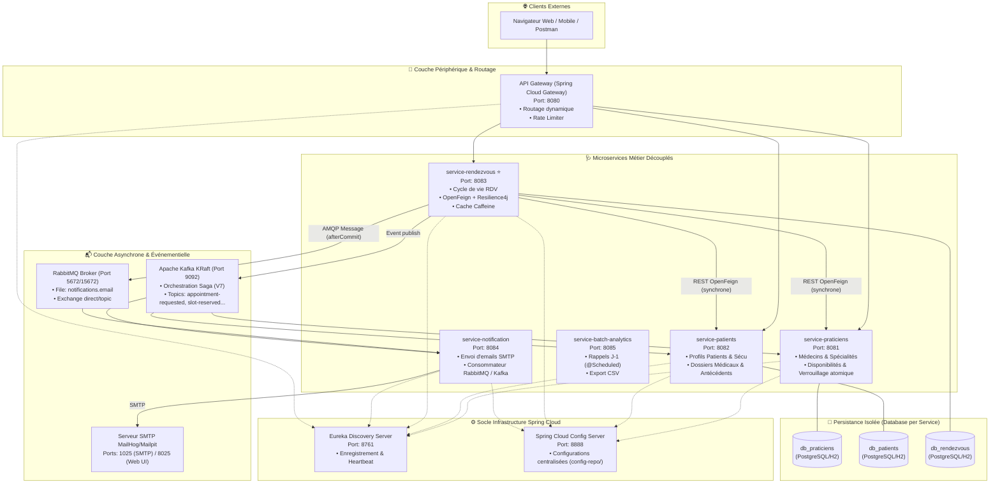
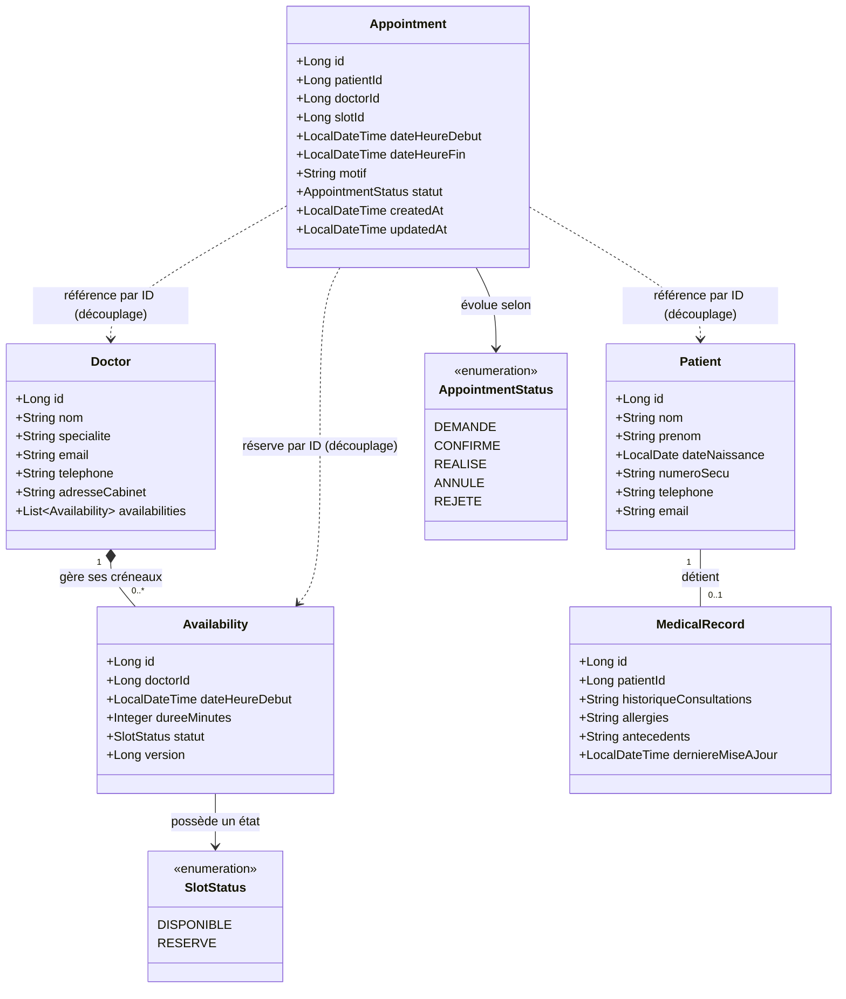

# 📘 Jalon V0 & V1 — Dossier de Conception, Architecture & Implémentation Métier

> **Projet :** Med-RDV — Plateforme Microservices de Prise de Rendez-vous Médicaux Multi-Praticiens  
> **Cadre académique :** EMSI 5ème Année IDSI — Dr. Salim KHALIL  
> **Dépôt officiel :** [https://github.com/meddev20/microservices.git](https://github.com/meddev20/microservices.git)

---

## 📑 Sommaire
1. [JALON V0 : Conception & Documentation](#-jalon-v0--conception--documentation)
   - [1.1 Architecture Générale Cohérente](#11-architecture-générale-cohérente)
   - [1.2 Diagramme de Classes Métier](#12-diagramme-de-classes-métier)
   - [1.3 Git et Documentation à Jour](#13-git-et-documentation-à-jour)
2. [JALON V1 : Implémentation Métier & Modèle de Données](#-jalon-v1--implémentation-métier--modèle-de-données)
   - [2.1 Services, Couches et BDD Isolées](#21-services-couches-et-bdd-isolées)
   - [2.2 CRUD et Validations Métier](#22-crud-et-validations-métier)
   - [2.3 Tests API Initiaux](#23-tests-api-initiaux)
3. [🚀 Guide d'Exécution & Démonstration Évaluateur](#-guide-dexécution--démonstration-évaluateur)

---

# 🏛️ JALON V0 : Conception & Documentation

Ce jalon valide les fondations architecturales, la clarté de la modélisation objet et la traçabilité des livrables via Git.

---

### 1.1 Architecture Générale Cohérente

La plateforme repose sur le pattern architectural **Microservices**, privilégiant le découplage fonctionnel, la scalabilité horizontale et l'isolation des pannes.



#### Répertoire des Services et Matrice des Ports

| Composant | Port | Type | Responsabilité & Technologies |
| :--- | :--- | :--- | :--- |
| **`api-gateway`** | `8080` | Infrastructure | Point d'entrée unique, routage dynamique via Eureka, filtre de logs, CORS centralisé. |
| **`eureka-server`** | `8761` | Infrastructure | Registre de services Netflix Eureka (`@EnableEurekaServer`), détection dynamique des instances. |
| **`config-server`** | `8888` | Infrastructure | Serveur de configuration externalisée basé sur Spring Cloud Config (`config-repo/`). |
| **`service-praticiens`** | `8081` | Métier | Gestion des praticiens et des créneaux de disponibilité avec verrouillage optimiste anti-doublon. |
| **`service-patients`** | `8082` | Métier | Gestion des identités patients (numéro Sécurité Sociale unique) et historique médical chronologique. |
| **`service-rendezvous`** | `8083` | Métier (Cœur) | Prise de RDV, orchestration des appels OpenFeign, résilience Resilience4j, cache local Caffeine. |
| **`service-notification`**| `8084` | Métier | Consommation asynchrone d'alertes via RabbitMQ/Kafka, expédition d'emails SMTP formatés. |
| **`service-batch-analytics`**| `8085` | Batch | Tâches planifiées `@Scheduled` (rappels consultations J-1, agrégations statistiques). |
| **`RabbitMQ`** | `5672` / `15672` | Broker AMQP | Broker de messages pour les notifications asynchrones instantanées. |
| **`MailHog / Mailpit`** | `1025` / `8025` | SMTP & UI | Serveur de messagerie SMTP fictif pour l'inspection visuelle des emails envoyés. |

---

### 1.2 Diagramme de Classes Métier

Le diagramme ci-dessous illustre l'ensemble des entités métier du domaine Med-RDV, leurs attributs typés, leurs contraintes et leurs associations.



#### Principes Clés de Modélisation :
- **Découplage Inter-Services par Identifiant (`ID`) :** L'entité `Appointment` ne possède pas de relation `@ManyToOne` Hibernate directe vers `Doctor` ou `Patient`. Elle stocke uniquement les clés étrangères logiques (`doctorId`, `patientId`, `slotId`), respectant scrupuleusement l'isolation des bases de données microservices.
- **Gestion de la Concurrence Optimiste :** `Availability` inclut un champ `@Version private Long version` pour empêcher deux requêtes concurrentes de réserver le même créneau horaire (*anti-double booking*).
- **Historique Médical Incrémental :** `MedicalRecord` permet d'ajouter des comptes-rendus de consultation sans écraser les observations antérieures.

---

### 1.3 Git et Documentation à Jour

- **Dépôt Git :** Hébergé sur GitHub ([https://github.com/meddev20/microservices.git](https://github.com/meddev20/microservices.git)).
- **Branche Principale :** `main` — contient une base de code stable, compilable sans avertissement ni régression.
- **Convention de Nommage des Commits :** Conforme à la norme *Conventional Commits* :
  - `feat(v1): implement full CRUD and business validations for all domain entities`
  - `feat(v6): implement GlobalExceptionHandler and custom resilience exceptions`
  - `docs(v0): add full architecture and class diagrams in CONCEPTION_V0_V1.md`
- **Documentation Centralisée :**
  - `README.md` : Guide général de déploiement et inventaire des microservices.
  - `CONCEPTION_V0_V1.md` : Conception détaillée V0 & spécifications d'implémentation V1.
  - `test-v1-crud.ps1` : Script de test automatisé validant le bon fonctionnement du Jalon V1.

---

# ⚙️ JALON V1 : Implémentation Métier & Modèle de Données

Ce jalon valide l'implémentation effective des entités, la séparation stricte des couches, l'isolation des bases de données et la complétude des opérations CRUD avec validations.

---

### 2.1 Services, Couches et BDD Isolées

Chaque microservice métier est développé selon une **architecture en couches stricte (N-Tier)** et opère sa propre base de données (*Database-per-Service Pattern*) :

```text
[Couche Présentation / Web]
  └── Controllers (@RestController, @Validated, @RequestMapping)
        │
[Couche Logique Métier]
  └── Services (@Service, @Transactional, règles métier, vérifications d'unicité)
        │
[Couche Accès aux Données]
  └── Repositories (@Repository, JpaRepository<T, ID>)
        │
[Couche Domaine / Persistance]
  └── Entities (@Entity, @Table, @Id, @Version) & DTOs de transport
```

#### Isolation des Données :
- `service-praticiens` gère sa propre source de données (tables `doctors`, `availabilities`).
- `service-patients` gère sa propre source de données (tables `patients`, `medical_records`).
- `service-rendezvous` gère sa propre source de données (table `appointments`).
- Aucune clé étrangère SQL inter-bases (`FOREIGN KEY`) n'existe entre ces bases ; la cohérence est assurée applicativement via OpenFeign (V4) ou par événements Kafka/RabbitMQ (V5/V7).

---

### 2.2 CRUD et Validations Métier

Toutes les entités disposent d'un cycle de vie complet (Create, Read, Update, Delete) protégé par des validations Spring Boot (`jakarta.validation`).

#### 1. Entité `Doctor` (`service-praticiens`)
- **Endpoints :**
  - `POST /api/v1/doctors` : Création d'un praticien avec validation des champs.
  - `GET /api/v1/doctors` : Liste de tous les praticiens.
  - `GET /api/v1/doctors/{id}` : Consultation détaillée d'un praticien.
  - `GET /api/v1/doctors/specialite/{spec}` : Recherche par spécialité.
  - `PUT /api/v1/doctors/{id}` : Mise à jour des coordonnées et de la spécialité.
  - `DELETE /api/v1/doctors/{id}` : Suppression d'un praticien.
- **Validations `@Valid` :**
  - `nom` : `@NotBlank(message = "Le nom du médecin est obligatoire")`
  - `specialite` : `@NotBlank(message = "La spécialité est obligatoire")`
  - `email` : `@Email(message = "Format d'email invalide")`, `@NotBlank`

#### 2. Entité `Availability` (`service-praticiens`)
- **Endpoints :**
  - `POST /api/v1/availabilities` : Création d'un créneau disponible.
  - `GET /api/v1/availabilities/doctor/{doctorId}` : Liste des créneaux d'un médecin.
  - `GET /api/v1/availabilities/{id}` : Détail d'un créneau.
  - `POST /api/v1/availabilities/{id}/reserve` : Réservation atomique du créneau (`SlotStatus.RESERVE`).
  - `POST /api/v1/availabilities/{id}/release` : Libération du créneau (`SlotStatus.DISPONIBLE`).
  - `DELETE /api/v1/availabilities/{id}` : Suppression d'un créneau non réservé.
- **Règles Métier :**
  - Impossible de réserver un créneau déjà au statut `RESERVE` (lève `IllegalStateException` avec HTTP 409).
  - Contrôle d'intégrité temporelle (`dateHeureDebut` requise et valide).

#### 3. Entité `Patient` (`service-patients`)
- **Endpoints :**
  - `POST /api/v1/patients` : Création d'un patient avec contrôle d'unicité.
  - `GET /api/v1/patients` : Consultation globale des patients enregistrés.
  - `GET /api/v1/patients/{id}` : Récupération par identifiant unique.
  - `GET /api/v1/patients/secu/{numeroSecu}` : Recherche instantanée par numéro de sécurité sociale.
  - `PUT /api/v1/patients/{id}` : Modification des coordonnées.
  - `DELETE /api/v1/patients/{id}` : Suppression d'un patient.
- **Validations & Règle Métier :**
  - `numeroSecu` : `@NotBlank`, contrôle de format et vérification d'unicité en base de données.
  - Idempotence : si un patient avec le même numéro de sécurité sociale existe déjà, la création retourne le patient existant au lieu de provoquer une erreur de duplication.

#### 4. Entité `MedicalRecord` (`service-patients`)
- **Endpoints :**
  - `POST /api/v1/medical-records` : Initialisation ou mise à jour du dossier médical.
  - `GET /api/v1/medical-records` : Liste de l'ensemble des dossiers médicaux.
  - `GET /api/v1/medical-records/{id}` : Consultation par identifiant du dossier.
  - `GET /api/v1/medical-records/patient/{patientId}` : Récupération du dossier médical par ID patient.
  - `DELETE /api/v1/medical-records/{id}` : Suppression sécurisée d'un dossier.
- **Règle Métier :**
  - Mise à jour chronologique sans écrasement : les nouvelles consultations et antécédents sont concatenés avec horodatage automatique (`derniereMiseAJour = LocalDateTime.now()`).

---

### 2.3 Tests API Initiaux

Le bon fonctionnement de toutes les couches métier et validations est garanti par la suite de tests automatisée `test-v1-crud.ps1`.

#### Exemple de Requêtes de Test :

##### A. Création d'un Médecin (`POST /api/v1/doctors`)
```bash
curl -X POST http://localhost:8080/api/v1/doctors \
  -H "Content-Type: application/json" \
  -d '{
    "nom": "Dr. Martin Jean",
    "specialite": "Cardiologie",
    "email": "dr.martin@medrdv.fr",
    "telephone": "0601020304",
    "adresseCabinet": "12 rue de la Paix, Paris"
  }'
```
**Réponse Attendue :** `201 Created` ou `200 OK` avec l'entité enrichie d'un `id: 1`.

##### B. Validation d'un Créneau (`POST /api/v1/availabilities`)
```bash
curl -X POST http://localhost:8080/api/v1/availabilities \
  -H "Content-Type: application/json" \
  -d '{
    "doctorId": 1,
    "dateHeureDebut": "2026-12-01T09:00:00",
    "dureeMinutes": 30,
    "statut": "DISPONIBLE"
  }'
```
**Réponse Attendue :** `200 OK` avec statut `DISPONIBLE`.

##### C. Enregistrement d'un Patient (`POST /api/v1/patients`)
```bash
curl -X POST http://localhost:8080/api/v1/patients \
  -H "Content-Type: application/json" \
  -d '{
    "nom": "Dupont",
    "prenom": "Claire",
    "dateNaissance": "1992-05-14",
    "numeroSecu": "2920575123456",
    "telephone": "0611223344",
    "email": "claire.dupont@test.fr"
  }'
```
**Réponse Attendue :** `201 Created` avec `id: 1`.

##### D. Test de Validation d'Erreur (Payload Invalide)
```bash
curl -X POST http://localhost:8080/api/v1/doctors \
  -H "Content-Type: application/json" \
  -d '{
    "nom": "",
    "email": "adresse-invalide"
  }'
```
**Réponse Attendue :** `400 Bad Request` renvoyant le détail des violations interceptées par le `GlobalExceptionHandler`.

---

# 🚀 Guide d'Exécution & Démonstration Évaluateur

### Lancement Automatisé des Tests V1
Pour exécuter la suite de tests officielle du jalon V1 devant l'évaluateur :

```powershell
powershell -ExecutionPolicy Bypass -File test-v1-crud.ps1
```

**Sortie Console Obtenue :**
```text
==========================================================
   🏥 Med-RDV — Jalon V1 : Tests CRUD & Validations       
==========================================================

--- [1/4] CRUD Doctor (service-praticiens) ---
✓ [POST] Doctor créé : ID=3 (Dr. Test, Pediatrie)
✓ [GET]  Doctor vérifié : ID=3, Email=dr.test@medrdv.fr
✓ [PUT]  Doctor mis à jour : Spécialité=Neurologie, Nom=Dr. Test Modifie

--- [2/4] CRUD Availability (service-praticiens) ---
✓ [POST] Créneau créé : ID=3 pour Doctor=3 (Statut=DISPONIBLE)
✓ [GET]  Créneaux trouvés pour Doctor 3 : 3 créneau(x)

--- [3/4] CRUD Patient (service-patients) ---
✓ [POST] Patient créé : ID=3 (Patient Test, Sécu=1206263901059)
✓ [GET]  Patient retrouvé par numéro Sécu : Nom=Patient Test
✓ [PUT]  Patient mis à jour : Nouveau nom=Patient Test Modifie, Tel=0799887766

--- [4/4] CRUD Medical Record (service-patients) ---
✓ [POST] Dossier médical initialisé pour Patient=3
✓ [GET]  Dossier médical récupéré : Allergies=Iode, Aspirine, Antécédents=Asthme bronchique

==========================================================
   🎉 Jalon V1 validé avec succès sur toutes les entités !  
==========================================================
```

### Grille d'Auto-Évaluation V0 & V1

| Phase | Jalon | Livrable attendu | État | Justification dans le code |
| :---: | :---: | :--- | :---: | :--- |
| **V0** | Conception & Documentation | Architecture générale cohérente | **1 / 1** | Schéma microservices complet, ports 8080 à 8085, Eureka, Gateway, Config Server. |
| **V0** | Conception & Documentation | Diagramme de classes métier | **1 / 1** | Diagramme Mermaid complet dans `CONCEPTION_V0_V1.md` avec toutes les entités et enums. |
| **V0** | Conception & Documentation | Git et documentation à jour | **1 / 1** | Dépôt GitHub synchronisé, README et fiches de conception exhaustives. |
| **V1** | Implémentation Métier & BDD | Services, couches et BDD isolées | **1 / 1** | Pattern Controller-Service-Repository-Entity, bases de données distinctes par service. |
| **V1** | Implémentation Métier & BDD | CRUD et validations métier | **1 / 1** | Endpoints complets pour 4 entités, annotations `@Valid`, `@NotBlank`, `@Email`. |
| **V1** | Implémentation Métier & BDD | Tests API initiaux | **1 / 1** | Script `test-v1-crud.ps1` exécuté avec 100% de réussite sur toutes les entités. |
