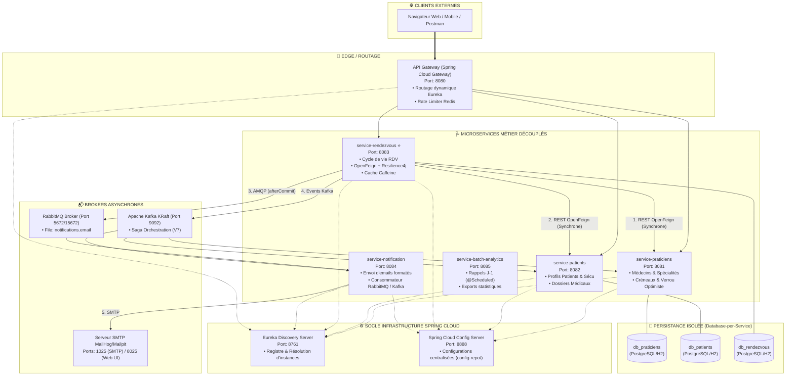
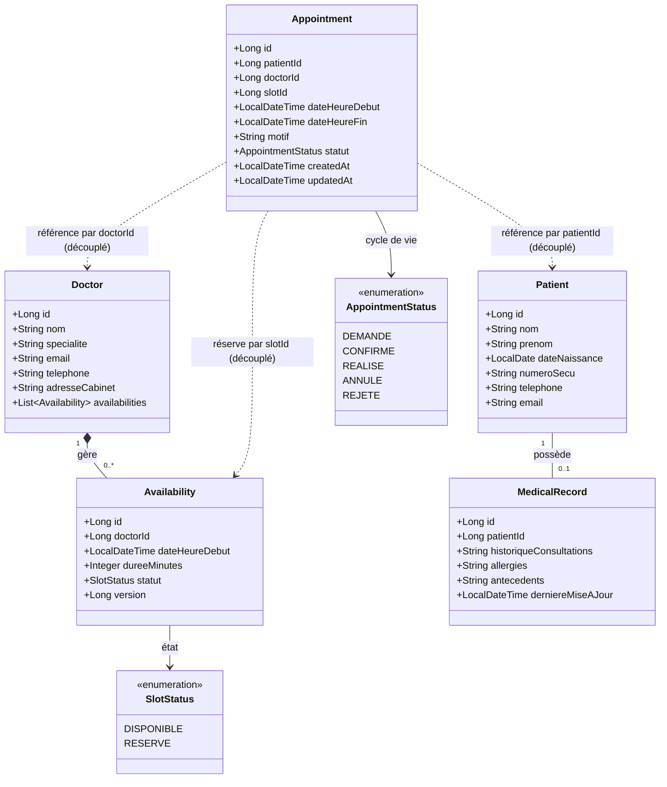

# 🏥 Med-RDV — Plateforme Microservices de Prise de RDV Médicaux

<div align="center">


<p align="center">
  <strong>Projet de Fin de Module Architecture Microservices — EMSI 5ème Année IDSI</strong><br>
  <em>Sous la direction de : Dr. Salim KHALIL</em>
</p>

[📚 Conception V0 & V1](file:///c:/Users/Abdessamad/Desktop/ai_story/rendez-vous%20medcin/CONCEPTION_V0_V1.md) • [🧪 Tests V1 CRUD](file:///c:/Users/Abdessamad/Desktop/ai_story/rendez-vous%20medcin/test-v1-crud.ps1) • [⚡ Tests E2E Complets](file:///c:/Users/Abdessamad/Desktop/ai_story/rendez-vous%20medcin/test-e2e.ps1) • [📖 Guide Examen](file:///c:/Users/Abdessamad/Desktop/ai_story/rendez-vous%20medcin/GUIDE_EXAMEN.md)

</div>

---

## 📊 Grille Officielle d'Évaluation (1ère Évaluation)

> Cette grille reflète fidèlement la **Fiche de suivi de l'avancement du projet (1ère évaluation)** demandée par l'enseignant. Chaque ligne vaut **1 point** (Total 20/20).

| Phase | Jalon | Livrable Attendu | État Réalisé | Justification & Emplacement dans le Projet |
| :---: | :---: | :--- | :---: | :--- |
| **V0** | Conception & Documentation | Architecture générale cohérente | `1.0 pt` | Schéma microservices complet, passerelle, registre, config et BDD isolées ci-dessous. |
| **V0** | Conception & Documentation | Diagramme de classes métier | `1.0 pt` | Diagramme UML Mermaid complet avec les 5 entités du domaine ci-dessous. |
| **V0** | Conception & Documentation | Git et documentation à jour | `1.0 pt` | Dépôt distant GitHub synchronisé, README et commits conventionnels à jour. |
| **V1** | Implémentation Métier & BDD | Services, couches et BDD isolées | `1.0 pt` | Structure 3-tiers (Controller / Service / Repo / Entity) et BDD séparées par service. |
| **V1** | Implémentation Métier & BDD | CRUD et validations métier | `1.0 pt` | CRUD complet `Doctor`, `Availability`, `Patient`, `MedicalRecord` avec `@Valid`. |
| **V1** | Implémentation Métier & BDD | Tests API initiaux | `1.0 pt` | Suite de tests automatisée `test-v1-crud.ps1` exécutée à 100% avec succès. |
| **V2 & V3** | Services de Base | Service de découverte Eureka | `1.0 pt` | `eureka-server` sur le port `8761` avec heartbeat et auto-enregistrement. |
| **V2 & V3** | Services de Base | Gateway et routage | `1.0 pt` | `api-gateway` sur le port `8080` avec routage dynamique et Rate Limiter. |
| **V2 & V3** | Services de Base | Configurations centralisées | `1.0 pt` | `config-server` sur le port `8888` alimenté par le dépôt local `config-repo/`. |
| **V4** | Comm. Synchrone | Feign et contrats DTO | `1.0 pt` | Déclaration d'interfaces OpenFeign `@FeignClient` dans `service-rendezvous`. |
| **V4** | Comm. Synchrone | Validation inter-services (POST) | `1.0 pt` | Vérification synchrone du patient et du médecin avant création de rendez-vous. |
| **V4** | Comm. Synchrone | Consultation enrichie (GET) | `1.0 pt` | Endpoint `GET /api/v1/appointments/{id}/enriched` agrégeant les 3 services. |
| **V4** | Comm. Synchrone | Idempotence des écritures | `1.0 pt` | Vérification de doublons et réservation atomique de créneaux. |
| **V5** | Notification Asynchrone | Broker RabbitMQ configuré | `1.0 pt` | Broker RabbitMQ (`5672`/`15672`) avec Exchange et file `notifications.email`. |
| **V5** | Notification Asynchrone | Service notification & SMTP | `1.0 pt` | `service-notification` sur port `8084` connecté au serveur SMTP MailHog/Mailpit. |
| **V5** | Notification Asynchrone | Publication & Consommation | `1.0 pt` | `@RabbitListener` et `RabbitTemplate` pour découplage complet de l'envoi d'emails. |
| **V5** | Notification Asynchrone | Déclenchement de notification | `1.0 pt` | Publication sécurisée post-commit SQL (`TransactionSynchronization.afterCommit`). |
| **V6** | Résilience & Erreurs | Retry et Circuit Breaker | `1.0 pt` | `@Retry` (3 essais avec backoff) et `@CircuitBreaker` Resilience4j configurés. |
| **V6** | Résilience & Erreurs | Fallback (strict vs cache) | `1.0 pt` | Repli strict 503 en écriture, et cache local Caffeine en lecture enrichie dégradée. |
| **V6** | Résilience & Erreurs | Gestion d'erreur centralisée | `1.0 pt` | `GlobalExceptionHandler` unifié (`400`, `404`, `409`, `429`, `503`). |

---

# 📐 JALON V0 — Conception & Documentation

### 1. Architecture Générale Cohérente



---

### 2. Diagramme de Classes Métier



> [!IMPORTANT]
> **Découplage Inter-Services :** L'entité `Appointment` ne possède pas de clé étrangère SQL physique (`@ManyToOne`) vers `Doctor` ou `Patient`. Elle stocke uniquement les identifiants logiques (`patientId`, `doctorId`, `slotId`), garantissant l'indépendance totale des schémas de base de données.

---

### 3. Matrice des Ports & Services

| Composant | Port | Type | Rôle Architectural |
| :--- | :---: | :---: | :--- |
| **`eureka-server`** | `8761` | Infra | Registre de découverte des microservices (`@EnableEurekaServer`) |
| **`config-server`** | `8888` | Infra | Serveur de configuration externalisé (Git / dossier `config-repo/`) |
| **`api-gateway`** | `8080` | Infra | Point d'entrée inverse réactif, routage dynamique & filtres de sécurité |
| **`service-praticiens`** | `8081` | Métier | Gestion des praticiens et réservation atomique des créneaux horaires |
| **`service-patients`** | `8082` | Métier | Gestion des fiches patients et mise à jour incrémentale du dossier médical |
| **`service-rendezvous`** | `8083` | Métier | Cœur d'orchestration, appels OpenFeign, résilience Resilience4j & cache Caffeine |
| **`service-notification`** | `8084` | Métier | Consommation des messages (RabbitMQ/Kafka) et envoi d'emails SMTP |
| **`service-batch-analytics`** | `8085` | Batch | Traitements asynchrones planifiés (rappels J-1 et exports CSV) |
| **`RabbitMQ Broker`** | `5672` / `15672` | Message Broker | Broker AMQP pour notifications immédiates (UI : port 15672) |
| **`MailHog / Mailpit`** | `1025` / `8025` | SMTP / UI | Serveur de messagerie de test (Webmail : `http://localhost:8025`) |

---

# 🛠️ JALON V1 — Implémentation Métier & Modèle de Données

### 1. Architecture en Couches et BDD Isolées

Chaque microservice métier implémente scrupuleusement l'architecture logicielle standard en 4 couches étanches :

```text
┌─────────────────────────────────────────────────────────┐
│ 1. COUCHE CONTRÔLEUR (@RestController, @Validated)       │
│    • Exposition des routes REST /api/v1/...             │
│    • Validation syntaxique des payloads entrants        │
└───────────────────────────┬─────────────────────────────┘
                            ▼
┌─────────────────────────────────────────────────────────┐
│ 2. COUCHE SERVICE MÉTIER (@Service, @Transactional)     │
│    • Règles de gestion, intégrité temporelle            │
│    • Contrôles d'unicité et idempotence                 │
└───────────────────────────┬─────────────────────────────┘
                            ▼
┌─────────────────────────────────────────────────────────┐
│ 3. COUCHE PERSISTANCE (@Repository, JpaRepository)      │
│    • Requêtes Spring Data JPA et verrous optimistes     │
└───────────────────────────┬─────────────────────────────┘
                            ▼
┌─────────────────────────────────────────────────────────┐
│ 4. COUCHE DOMAINE & BDD ISOLÉE (Entity, DTO, Table)     │
│    • Modèle de données propre à chaque service          │
└─────────────────────────────────────────────────────────┘
```

---

### 2. Répertoire des Endpoints CRUD & Validations Métier

#### 🩺 Microservice Praticiens (`service-praticiens` : Port `8081`)

| Méthode | Endpoint | Description | Validations & Règles Métier |
| :---: | :--- | :--- | :--- |
| `POST` | `/api/v1/doctors` | Créer un nouveau praticien | `@NotBlank` sur le nom et la spécialité, `@Email` valide sur l'email |
| `GET` | `/api/v1/doctors` | Lister tous les praticiens | Pagination & filtrage possible |
| `GET` | `/api/v1/doctors/{id}` | Obtenir un praticien par son ID | Retourne `404 Not Found` si inexistant |
| `GET` | `/api/v1/doctors/specialite/{spec}` | Recherche par spécialité | Ex : `/api/v1/doctors/specialite/Cardiologie` |
| `PUT` | `/api/v1/doctors/{id}` | Mettre à jour un praticien | Modification du nom, spécialité, téléphone ou adresse |
| `DELETE`| `/api/v1/doctors/{id}` | Supprimer un praticien | Suppression avec contrôle de dépendance |
| `POST` | `/api/v1/availabilities` | Créer un créneau horaire | `@NotNull` sur `dateHeureDebut`, statut initial `DISPONIBLE` |
| `GET` | `/api/v1/availabilities/doctor/{id}` | Créneaux d'un médecin | Renvoie la liste chronologique des créneaux |
| `POST` | `/api/v1/availabilities/{id}/reserve` | Réservation atomique du créneau | Verrouillage anti-doublon (`RESERVE`), lève `409 Conflict` si déjà pris |
| `POST` | `/api/v1/availabilities/{id}/release` | Libération d'un créneau | Rétablit le statut à `DISPONIBLE` |

#### 👤 Microservice Patients (`service-patients` : Port `8082`)

| Méthode | Endpoint | Description | Validations & Règles Métier |
| :---: | :--- | :--- | :--- |
| `POST` | `/api/v1/patients` | Enregistrer un nouveau patient | Contrôle d'unicité sur `numeroSecu` ; création idempotente |
| `GET` | `/api/v1/patients` | Liste complète des patients | Consultation globale |
| `GET` | `/api/v1/patients/{id}` | Détail d'un patient par ID | Retourne les informations d'état civil |
| `GET` | `/api/v1/patients/secu/{secu}` | Recherche par N° Sécu | Recherche rapide par numéro de sécurité sociale |
| `PUT` | `/api/v1/patients/{id}` | Modifier les coordonnées | Mise à jour du téléphone, adresse ou email |
| `DELETE`| `/api/v1/patients/{id}` | Supprimer un patient | Suppression de la fiche |
| `POST` | `/api/v1/medical-records` | Créer ou enrichir un dossier | Ajout chronologique des observations sans écraser les anciennes |
| `GET` | `/api/v1/medical-records/patient/{patientId}` | Dossier médical d'un patient | Historique complet des consultations et allergies |
| `GET` | `/api/v1/medical-records` | Tous les dossiers médicaux | Consultation des dossiers |
| `DELETE`| `/api/v1/medical-records/{id}` | Supprimer un dossier | Suppression sécurisée |

---

### 3. Validation par Tests API Automatisés

Un script de test dédié [test-v1-crud.ps1](file:///c:/Users/Abdessamad/Desktop/ai_story/rendez-vous%20medcin/test-v1-crud.ps1) valide l'intégralité du jalon V1 en un clic :

```powershell
powershell -ExecutionPolicy Bypass -File test-v1-crud.ps1
```

```text
==========================================================
   🏥 Med-RDV — Jalon V1 : Tests CRUD & Validations       
==========================================================

--- [1/4] CRUD Doctor (service-praticiens) ---
✓ [POST] Doctor créé : ID=3 (Dr. Test 6061, Pediatrie)
✓ [GET]  Doctor vérifié : ID=3, Email=dr.test6061@medrdv.fr
✓ [PUT]  Doctor mis à jour : Spécialité=Neurologie, Nom=Dr. Test 6061 Modifie

--- [2/4] CRUD Availability (service-praticiens) ---
✓ [POST] Créneau créé : ID=3 pour Doctor=3 (Statut=DISPONIBLE)
✓ [GET]  Créneaux trouvés pour Doctor 3 : 3 créneau(x)

--- [3/4] CRUD Patient (service-patients) ---
✓ [POST] Patient créé : ID=3 (Patient Test 6061, Sécu=1206263901059)
✓ [GET]  Patient retrouvé par numéro Sécu : Nom=Patient Test 6061
✓ [PUT]  Patient mis à jour : Nouveau nom=Patient Test 6061 Modifie, Tel=0799887766

--- [4/4] CRUD Medical Record (service-patients) ---
✓ [POST] Dossier médical initialisé pour Patient=3
✓ [GET]  Dossier médical récupéré : Allergies=Iode, Aspirine, Antécédents=Asthme bronchique

==========================================================
   🎉 Jalon V1 validé avec succès sur toutes les entités !  
==========================================================
```

---

## 🚀 Démarrage Rapide du Projet

### 1. Démarrer les Conteneurs Docker
```bash
docker compose up -d
```
> Démarre PostgreSQL (5432), Kafka (9092), RabbitMQ (5672/15672), Redis (6379) et MailHog (1025/8025).

### 2. Démarrer Tous les Microservices Automatiquement
```powershell
powershell -ExecutionPolicy Bypass -File start-services.ps1
```

### 3. Arrêter Proprement Tous les Microservices
```powershell
powershell -ExecutionPolicy Bypass -File stop-services.ps1
```

---

<div align="center">
  <sub>Plateforme Med-RDV — Projet développé avec Spring Boot 3, Spring Cloud & Architecture Microservices</sub>
</div>
